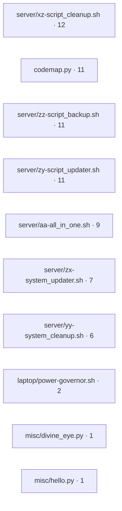
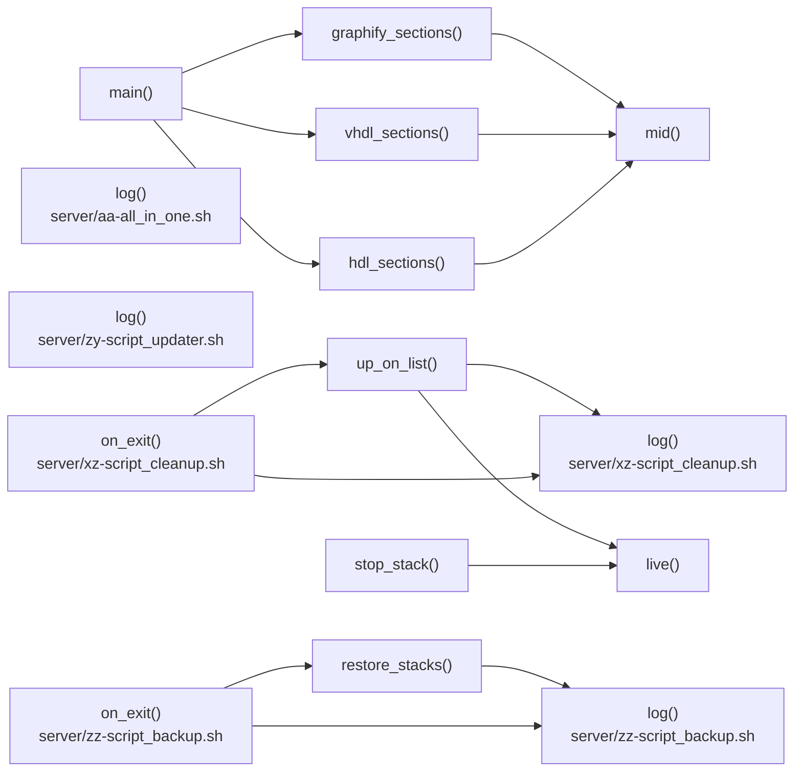

# Codemap: scripts

← [README](README.md)

> Generated from commit `6c1fdda` by `scripts/codemap.py`. Regenerate it from the workspace root with `python3 scripts/codemap.py scripts`; don't edit it by hand.

## Files

Each box is a source file and its function count; an arrow means calls into that file.

## Hubs

The most connected functions: where a change reaches furthest.

| Function | Where | Called by | Calls |
|---|---|---|---|
| `restore_stacks()` | `server/zz-script_backup.sh:137` | 1 | 4 |
| `graphify_sections()` | `codemap.py:55` | 1 | 3 |
| `main()` | `codemap.py:251` | 0 | 4 |
| `up_on_list()` | `server/xz-script_cleanup.sh:139` | 1 | 3 |
| `vhdl_sections()` | `codemap.py:163` | 1 | 3 |
| `log()` | `server/aa-all_in_one.sh:64` | 3 | 0 |
| `mid()` | `codemap.py:38` | 3 | 0 |
| `stop_stack()` | `server/xz-script_cleanup.sh:124` | 0 | 3 |
| `hdl_sections()` | `codemap.py:214` | 1 | 1 |
| `live()` | `server/xz-script_cleanup.sh:68` | 2 | 0 |
| `log()` | `server/xz-script_cleanup.sh:61` | 2 | 0 |
| `log()` | `server/zz-script_backup.sh:61` | 2 | 0 |
| `log()` | `server/zy-script_updater.sh:64` | 2 | 0 |
| `on_exit()` | `server/xz-script_cleanup.sh:159` | 0 | 2 |
| `on_exit()` | `server/zz-script_backup.sh:178` | 0 | 2 |

## Functions

### `codemap.py`

- `run()` L34
- `mid()` L38
- `q()` L43
- `kept()` L48
- `graphify_sections()` L55 → `mid()`, `q()`, `kept()`
- `line()` L89
- `name()` L93
- `strip_vhdl_comments()` L159
- `vhdl_sections()` L163 → `strip_vhdl_comments()`, `mid()`, `q()`
- `hdl_sections()` L214 → `mid()`
- `main()` L251 → `run()`, `hdl_sections()`, `vhdl_sections()`, `graphify_sections()`

### `laptop/power-governor.sh`

- `get_signature()` L16
- `hypr_cmd()` L35

### `misc/divine_eye.py`

- `frame_to_ascii()` L10

### `misc/hello.py`

- `main()` L1

### `server/aa-all_in_one.sh`

- `ts()` L63
- `log()` L64
- `die()` L65
- `used_kb()` L69
- `human()` L74
- `newest_backup()` L82
- `step()` L87 → `log()`
- `dns_up()` L114 → `log()`
- `on_exit()` L122 → `log()`, `step()`

### `server/xz-script_cleanup.sh`

- `ts()` L60
- `log()` L61
- `warn()` L62
- `die()` L63
- `live()` L68
- `in_list()` L100
- `running_ids()` L109
- `compose()` L116
- `stop_stack()` L124 → `live()`, `warn()`, `running_ids()`
- `up_on_list()` L139 → `log()`, `live()`, `warn()`
- `on_exit()` L159 → `up_on_list()`, `log()`
- `declared_volumes()` L289

### `server/yy-system_cleanup.sh`

- `ts()` L38
- `log()` L39
- `warn()` L40
- `die()` L41
- `on_exit()` L43 → `log()`
- `used_mb()` L61

### `server/zx-system_updater.sh`

- `ts()` L34
- `log()` L35
- `warn()` L36
- `die()` L37
- `detail()` L40
- `on_exit()` L44 → `log()`
- `free_mb()` L62

### `server/zy-script_updater.sh`

- `ts()` L63
- `log()` L64
- `warn()` L65
- `die()` L66
- `detail()` L69
- `live()` L77
- `in_list()` L109
- `compose()` L119
- `running_images()` L128
- `keep_previous()` L136 → `log()`
- `on_exit()` L149 → `warn()`, `log()`

### `server/zz-script_backup.sh`

- `ts()` L60
- `log()` L61
- `warn()` L62
- `die()` L63
- `live()` L69
- `in_list()` L101
- `running_ids()` L112
- `compose()` L119
- `start_leftovers()` L128
- `restore_stacks()` L137 → `log()`, `live()`, `warn()`, `start_leftovers()`
- `on_exit()` L178 → `restore_stacks()`, `log()`
