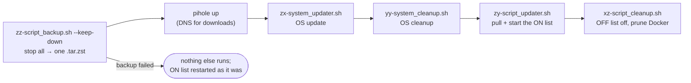
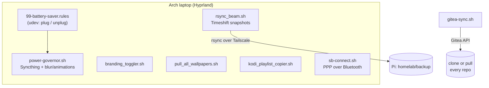

# scripts

> Standalone bash and Python automation for the homelab server, the Hyprland laptop and the workspace itself.

## Overview

One file per job, no framework. Names sort by tier: **`z`/`y`/`x`-prefixed scripts are the server maintenance tier** and sort last; unprefixed ones are ordinary tools. The maintenance scripts share one config, [`homelab-stacks.conf`](homelab-stacks.conf), which lists the compose stacks that should be ON (also their start order) and OFF.

## The Maintenance Run

`aa-all_in_one.sh` chains the tier so every container stops once and starts once:

Whatever happens (an error, Ctrl+C, SIGTERM), the ON list is started before it exits. Run it in **tmux**.

| Script | Does | Usage |
|---|---|---|
| `aa-all_in_one.sh` | The whole run above, logging each step | `sudo ./aa-all_in_one.sh [-y] [--volumes]` |
| `zz-script_backup.sh` | Cold backup: stop everything, pack `containers/` into `backup/containers/<date>.tar.zst` with owners and permissions, bring the ON list back | `sudo ./zz-script_backup.sh [--keep-down]` |
| `zy-script_updater.sh` | Pull and `up -d` the ON list; keeps each replaced image as `<image>:previous` for a one-step rollback | `sudo ./zy-script_updater.sh [--pull-only]` |
| `zx-system_updater.sh` | OS update: asks first, keeps local configs, waits on the apt lock, says when to reboot | `sudo ./zx-system_updater.sh [-y]` |
| `yy-system_cleanup.sh` | Autoremove, purge leftover configs, empty the apt cache, trim the journal; never the running kernel | `sudo ./yy-system_cleanup.sh [-y]` |
| `xz-script_cleanup.sh` | Enforce ON/OFF, then prune unused images, networks and build cache; `--volumes` also deletes unused volumes (**not reversible**) | `sudo ./xz-script_cleanup.sh [--restart] [--volumes]` |
| `zw-https_renewer.sh` | Renew a Tailscale cert and copy it into nginx (from the Nginx Proxy Manager era) | `./zw-https_renewer.sh` |

Exit codes for the tier: **0** ok, **1** fatal, **2** finished with warnings. These target `~/homelab/containers` **on the server**, not a dev machine.

## Everything Else

| Script | Does |
|---|---|
| `gitea-sync.sh [dir]` | **The workspace bootstrap:** lists every repo through the Gitea API and clones or pulls each one. Needs `jq` |
| `power-governor.sh battery\|ac` | On battery: stops Syncthing and turns Hyprland's blur and animations off; on AC: back on. Finds the instance signature under `$XDG_RUNTIME_DIR/hypr/` and drives `hyprctl` as the user via `sudo -u`. Fired by `99-battery-saver.rules` |
| `sb-connect.sh` | Brings up PPP over a Bluetooth rfcomm link to a phone, with a bounded wake-up retry. The device MAC is hardcoded at the top |
| `rsync_beam.sh` | Sends the laptop's Timeshift snapshots to the Pi over Tailscale (run as root) |
| `branding_toggler.sh` | Flips the screensaver and about text between two brandings |
| `pull_all_wallpapers.sh` | Symlinks Wallpaper Engine workshop files into `~/Pictures/Wallpapers/Steam` and drops broken links |
| `kodi_playlist_copier.sh` | Copies every `.m3u8` from the music library into Kodi's playlists |
| `divine_eye.py` | Webcam to ASCII art in the terminal (OpenCV) |
| `hello.py` | Hello, world |

---
*powered by logic, coffee, and many sleepless nights*
